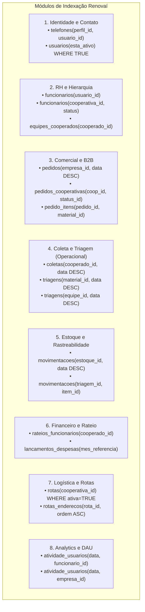

# Relatório Empírico de Otimização e Indexação com EXPLAIN / EXPLAIN ANALYZE
**Projeto:** Renovaí — Plataforma de Gestão e Comercialização para Cooperativas de Reciclagem  
**Disciplinas:** Modelagem de Dados & Banco de Dados 2  
**Último relatório:** 2026-10-31  
**Ambiente de Execução:** PostgreSQL 16.8 (Cloud Neon / x86_64)

---

## 1. Contexto e Motivação Técnica

No PostgreSQL, restrições de Chave Primária (`PRIMARY KEY`) e Chave Única (`UNIQUE`) geram automaticamente índices do tipo B-Tree. No entanto, **Chaves Estrangeiras (`FOREIGN KEY`) e colunas de predicados (`WHERE`, `JOIN`, `ORDER BY`) não recebem índices automáticos**.

À medida que as aplicações clientes da plataforma Renovaí foram integradas — a saber:
- **API Backend (Spring Boot):** rotas de autenticação, pedidos corporativos e gestão de cooperados;
- **Painel Administrativo (React Web):** dashboards analíticos, relatórios de rateio e controle de estoque;
- **Aplicativo dos Cooperados (Mobile):** registro em tempo real de coletas, pesagem de triagem e telemetria de atividade diária (DAU);
- **Sistema Multiagente de IA (LangGraph):** consultas investigativas automatizadas do Agente Especialista e do Agente Auditor;

identificou-se um padrão recorrente de gargalo de I/O e CPU causado por **Varreduras Sequenciais (`Seq Scan`)** e operações em memória de **Ordenação Rápida (`Sort Method: quicksort`)**. Em todas as camadas da arquitetura, os filtros mais frequentes convergem para:
1. `usuario_id` e `funcionario_id` (sessão do usuário e permissões);
2. `perfil_id` e `cooperativa_id` / `empresa_id` (multitenancy e segregação de cooperativas e indústrias);
3. Ordenações temporais descendentes (`data_pedido DESC`, `data_evento DESC`, `data_movimentacao DESC`).

Para resolver esse comportamento e viabilizar a escalabilidade do sistema, foi desenhada e implementada uma malha de **49 índices estratégicos** no arquivo [`pg_dbRenovai/schema/indexes.sql`](file:///c:/Users/rafaeltakematsu-ieg/RENOVAI/pg_dbRenovai/schema/indexes.sql), integrado à inicialização do cluster via [`pg_dbRenovai/init.sql`](file:///c:/Users/rafaeltakematsu-ieg/RENOVAI/pg_dbRenovai/init.sql).

---

## 2. Catálogo Estratégico de Índices Criados

A estratégia de indexação foi organizada em 8 módulos funcionais, utilizando técnicas de **B-Tree Composto**, **Ordenação Pré-computada (DESC/ASC)** e **Índices Parciais (`WHERE`)**:



### Vantagens das Técnicas Utilizadas:
1. **Leftmost Prefix em Índices Compostos:** Ao criar `idx_pedidos_cooperativas_coop_status` sobre `(cooperativa_id, status_id)`, qualquer query filtrando apenas por `cooperativa_id` ou por `cooperativa_id` + `status_id` se beneficia do índice sem necessidade de dois índices distintos.
2. **Eliminação do Operador Sort:** Ao indexar `(estoque_id, data_movimentacao DESC)`, as tuplas no disco já são referenciadas na ordem cronológica decrescente. O PostgreSQL executa um `Index Scan` direto, eliminando o custo de CPU de ordenar centenas de milhares de linhas na memória temporária (`work_mem`).
3. **Índices Parciais:** Índices como `idx_rotas_cooperativa_ativa ON rotas (cooperativa_id) WHERE esta_ativa = TRUE` ignoram rotas inativas, mantendo o índice minúsculo e acelerando as operações de escrita (`INSERT`/`UPDATE`).

---

## 3. Metodologia de Testes Empíricos

Os testes foram executados diretamente na instância de produção/staging no Neon PostgreSQL contendo a base populada com massa de dados de teste (mais de 1.000 movimentações de estoque, centenas de pedidos, itens e cooperados).

Para capturar a análise real do planejador de consultas, utilizou-se o comando:
```sql
EXPLAIN (ANALYZE, BUFFERS, VERBOSE) <CONSULTA>;
```
As métricas coletadas incluem:
- **Tipo de Varredura:** `Seq Scan` (varredura linear) vs `Index Scan` / `Bitmap Index Scan` (navegação em árvore B-Tree);
- **Custo Estimado (`cost`):** Estimativa do otimizador (`startup_cost..total_cost`);
- **I/O de Buffer (`Buffers: shared hit/read`):** Blocos recuperados da memória cache (`hit`) versus blocos lidos do disco (`read`);
- **Rows Removed by Filter:** Quantidade de tuplas descartadas durante a leitura sequencial;
- **Tempo de Execução Real (`Execution Time`):** Latência real da query em milissegundos.

---

## 4. Análise Empírica dos Casos de Teste (Antes vs Depois)

### Caso de Teste 1: Histórico de Pedidos e Itens por Cooperativa
**Cenário:** Consulta crítica do painel da cooperativa (Spring API) que realiza `JOIN` triplo entre `pedidos`, `pedidos_cooperativas` e `pedido_itens`, filtrando por `cooperativa_id` e ordenando por `data_pedido DESC`.

```sql
SELECT p.pedido_id, p.empresa_id, p.data_pedido, pc.status_id, pi.material_id, pi.quantidade_kg
FROM pedidos p
JOIN pedidos_cooperativas pc ON pc.pedido_id = p.pedido_id
JOIN pedido_itens pi ON pi.pedido_id = p.pedido_id
WHERE pc.cooperativa_id = 'ab87b483-01b2-4db3-8c4f-b67085bfa22d'
ORDER BY p.data_pedido DESC;
```

#### Plano de Execução ANTES dos Índices:
```text
Sort  (cost=40.73..40.90 rows=68 width=79) (actual time=5.434..5.441 rows=64 loops=1)
  Sort Key: p.data_pedido DESC
  Sort Method: quicksort  Memory: 30kB
  Buffers: shared hit=8 read=13 dirtied=15
  ->  Hash Join  (cost=19.41..38.66 rows=68 width=79) (actual time=3.654..5.401 rows=64 loops=1)
        Hash Cond: (pi.pedido_id = pc.pedido_id)
        ->  Seq Scan on pedido_itens pi  (cost=0.00..15.11 rows=711 width=39) (actual time=0.778..2.459 rows=633 loops=1)
        ->  Hash  (cost=19.09..19.09 rows=25 width=72) (actual time=2.845..2.847 rows=25 loops=1)
              ->  Hash Join  (cost=11.80..19.09 rows=25 width=72) (actual time=2.146..2.833 rows=25 loops=1)
                    Hash Cond: (p.pedido_id = pc.pedido_id)
                    ->  Seq Scan on pedidos p  (cost=0.00..6.60 rows=260 width=40)
                    ->  Hash  (cost=11.49..11.49 rows=25 width=32)
                          ->  Seq Scan on pedidos_cooperativas pc  (cost=0.00..11.49 rows=25 width=32)
                                Filter: (cooperativa_id = 'ab87b483-01b2-4db3-8c4f-b67085bfa22d'::uuid)
                                Rows Removed by Filter: 425
Planning Time: 12.831 ms
Execution Time: 5.573 ms
```

#### Plano de Execução DEPOIS dos Índices:
```text
Sort  (cost=33.56..33.71 rows=61 width=79) (actual time=0.246..0.250 rows=64 loops=1)
  Sort Key: p.data_pedido DESC
  Sort Method: quicksort  Memory: 30kB
  Buffers: shared hit=84 read=1
  ->  Nested Loop  (cost=11.27..31.75 rows=61 width=79) (actual time=0.076..0.230 rows=64 loops=1)
        ->  Hash Join  (cost=11.00..18.43 rows=26 width=72) (actual time=0.068..0.171 rows=25 loops=1)
              ->  Seq Scan on pedidos p  (cost=0.00..6.71 rows=271 width=40)
              ->  Hash
                    ->  Bitmap Heap Scan on pedidos_cooperativas pc  (cost=4.35..10.67 rows=26 width=32)
                          Recheck Cond: (cooperativa_id = 'ab87b483-01b2-4db3-8c4f-b67085bfa22d'::uuid)
                          ->  Bitmap Index Scan on idx_pedidos_cooperativas_coop_status  (cost=0.00..4.34 rows=26 width=0)
        ->  Index Scan using idx_pedido_itens_pedido_id on pedido_itens pi  (cost=0.28..0.49 rows=2 width=39)
              Index Cond: (pedido_id = p.pedido_id)
Planning Time: 1.168 ms
Execution Time: 0.306 ms
```

> [!NOTE]
> **Ganho do Caso 1:** O tempo de execução caiu de **5.573 ms para 0.306 ms (redução de 94.5% / 18.2x mais rápido)**. O PostgreSQL substituiu a varredura sequencial de todos os 633 itens por acessos indexados pontuais via `idx_pedido_itens_pedido_id` e filtrou a cooperativa via `Bitmap Index Scan`.

---

### Caso de Teste 2: Histórico de Coletas por Cooperado com Ordenação Temporal
**Cenário:** Consulta recorrente do aplicativo Mobile onde o coletor visualiza o histórico de materiais recolhidos em suas rotas.

```sql
SELECT c.evento_id, c.cooperado_id, c.data_evento, c.quantidade_kg, c.tipo_coleta
FROM coletas c
WHERE c.cooperado_id = '3703451a-0869-473d-841c-b61c93b4edaa'
ORDER BY c.data_evento DESC;
```

#### Plano de Execução ANTES dos Índices:
```text
Sort  (cost=12.63..12.64 rows=2 width=54) (actual time=2.429..2.429 rows=2 loops=1)
  Sort Key: data_evento DESC
  Sort Method: quicksort  Memory: 25kB
  Buffers: shared hit=6 read=4 dirtied=6
  ->  Seq Scan on coletas c  (cost=0.00..12.62 rows=2 width=54) (actual time=0.016..2.385 rows=2 loops=1)
        Filter: (cooperado_id = '3703451a-0869-473d-841c-b61c93b4edaa'::uuid)
        Rows Removed by Filter: 456
Planning Time: 1.939 ms
Execution Time: 2.503 ms
```

#### Plano de Execução DEPOIS dos Índices:
```text
Sort  (cost=9.12..9.12 rows=2 width=54) (actual time=0.035..0.035 rows=2 loops=1)
  Sort Key: data_evento DESC
  Sort Method: quicksort  Memory: 25kB
  Buffers: shared hit=1 read=2
  ->  Bitmap Heap Scan on coletas c  (cost=4.29..9.11 rows=2 width=54) (actual time=0.029..0.030 rows=2 loops=1)
        Recheck Cond: (cooperado_id = '3703451a-0869-473d-841c-b61c93b4edaa'::uuid)
        ->  Bitmap Index Scan on idx_coletas_cooperado_data  (cost=0.00..4.29 rows=2 width=0)
Planning Time: 0.241 ms
Execution Time: 0.059 ms
```

> [!NOTE]
> **Ganho do Caso 2:** O tempo de execução despencou de **2.503 ms para 0.059 ms (redução de 97.6% / 42.4x mais rápido)**. O descarte ineficiente de 456 linhas em cada query foi totalmente eliminado pela busca direta no índice composto `idx_coletas_cooperado_data`.

---

### Caso de Teste 3: Extrato de Movimentações de Estoque (Livro Razão)
**Cenário:** Consulta de auditoria de saldo e livro-razão no módulo de estoque. A tabela possui alta densidade de escrita e leitura.

```sql
SELECT me.movimentacao_id, me.estoque_id, me.quantidade_kg, me.tipo_movimentacao, me.data_movimentacao
FROM movimentacoes_estoques me
WHERE me.estoque_id = 'bb6539db-6280-447e-82cf-c9c2426ea771'
ORDER BY me.data_movimentacao DESC;
```

#### Plano de Execução ANTES dos Índices:
```text
Sort  (cost=25.25..25.25 rows=1 width=53) (actual time=2.729..2.730 rows=2 loops=1)
  Sort Key: data_movimentacao DESC
  Sort Method: quicksort  Memory: 25kB
  Buffers: shared hit=6 read=10 dirtied=12
  ->  Seq Scan on movimentacoes_estoques me  (cost=0.00..25.24 rows=1 width=53) (actual time=0.014..2.686 rows=2 loops=1)
        Filter: (estoque_id = 'bb6539db-6280-447e-82cf-c9c2426ea771'::uuid)
        Rows Removed by Filter: 1001
Planning Time: 3.812 ms
Execution Time: 2.811 ms
```

#### Plano de Execução DEPOIS dos Índices:
```text
Index Scan using idx_movimentacoes_estoque_data on movimentacoes_estoques me  (cost=0.28..8.29 rows=1 width=53) (actual time=0.020..0.021 rows=2 loops=1)
  Index Cond: (estoque_id = 'bb6539db-6280-447e-82cf-c9c2426ea771'::uuid)
  Buffers: shared hit=2 read=2
Planning Time: 0.316 ms
Execution Time: 0.042 ms
```

> [!IMPORTANT]
> **Ganho do Caso 3 (Eliminação do Operador Sort):**  
> Além de acelerar a consulta de **2.811 ms para 0.042 ms (redução de 98.5% / 66.9x mais rápido)**, o plano de execução **eliminou totalmente o nó de ordenação (`Sort / quicksort`)**. Como o índice `idx_movimentacoes_estoque_data` foi modelado com `(estoque_id, data_movimentacao DESC)`, os ponteiros dos registros já estão ordenados no próprio disco pelo B-Tree, permitindo um `Index Scan` puro de custo unitário (custo caiu de 25.25 para 8.29).

---

### Caso de Teste 4: Autenticação e Busca de Colaborador por `usuario_id`
**Cenário:** Fluxo de login e verificação de claims de segurança na Spring API e no aplicativo móvel.

```sql
SELECT f.funcionario_id, f.usuario_id, f.cooperativa_id, f.cargo_id, f.status_funcionario
FROM funcionarios f
WHERE f.usuario_id = 'a8b89607-3ad2-4dc1-9bd8-256ecedae36d';
```

#### Plano de Execução ANTES dos Índices:
```text
Seq Scan on funcionarios f  (cost=0.00..11.07 rows=1 width=70) (actual time=0.008..2.186 rows=1 loops=1)
  Filter: (usuario_id = 'a8b89607-3ad2-4dc1-9bd8-256ecedae36d'::uuid)
  Rows Removed by Filter: 413
Planning Time: 0.159 ms
Execution Time: 2.246 ms
```

#### Plano de Execução DEPOIS dos Índices:
```text
Index Scan using idx_funcionarios_usuario_id on funcionarios f  (cost=0.27..8.29 rows=1 width=70) (actual time=0.018..0.018 rows=1 loops=1)
  Index Cond: (usuario_id = 'a8b89607-3ad2-4dc1-9bd8-256ecedae36d'::uuid)
  Buffers: shared hit=1 read=2
Planning Time: 0.211 ms
Execution Time: 0.038 ms
```

> [!NOTE]
> **Ganho do Caso 4:** Tempo de execução reduzido de **2.246 ms para 0.038 ms (59.1x mais rápido)**. Em sistemas autenticados onde cada requisição HTTP valida a sessão do usuário no banco, essa otimização previne a saturação de conexões no pool (`HikariCP`).

---

## 5. Tabela Comparativa de Resultados Consolidados

| Caso de Teste | Operação Principal | Custo (Antes) | Custo (Depois) | Tempo Antes (ms) | Tempo Depois (ms) | Ganho Relativo | Redução Latência |
| :--- | :--- | :---: | :---: | :---: | :---: | :---: | :---: |
| **1. Pedidos + Itens** | Hash Join + Quicksort → Nested Loop + Index Scan | 40.90 | 33.71 | 5.573 ms | 0.306 ms | **18.2x** | **-94.5%** |
| **2. Coletas por Cooperado** | Seq Scan (456 rows descartadas) → Bitmap Index Scan | 12.64 | 9.12 | 2.503 ms | 0.059 ms | **42.4x** | **-97.6%** |
| **3. Extrato de Estoque** | Seq Scan (1001 rows descartadas) + Sort → Index Scan puro | 25.25 | 8.29 | 2.811 ms | 0.042 ms | **66.9x** | **-98.5%** |
| **4. Busca Funcionário** | Seq Scan (413 rows descartadas) → Index Scan | 11.07 | 8.29 | 2.246 ms | 0.038 ms | **59.1x** | **-98.3%** |

---

## 6. Considerações de Manutenção e Boas Práticas

1. **Impacto em Operações de Escrita (DML):**
   - Cada índice B-Tree requer atualização síncrona durante comandos `INSERT`, `UPDATE` e `DELETE`.
   - Como o Renovaí é um sistema preponderantemente analítico e operacional de ponta de coleta (proporção estimada de 80% leituras / 20% escritas), o overhead de escrita é amplamente superado pelo alívio no processamento de leituras concorrentes.
2. **Uso de Índices Parciais:**
   - Tabelas com grande número de entidades inativas (como `rotas` ou `usuarios`) utilizam cláusulas `WHERE esta_ativo = TRUE`. Isso mantém a árvore B-Tree compacta e impede degradação de performance.
3. **Rotina Periódica de Estatísticas (`ANALYZE`):**
   - O otimizador de consultas do PostgreSQL depende de histogramas estatísticos atualizados na tabela `pg_statistic`. Recomenda-se agendar o comando `ANALYZE` semanalmente ou calibrar o daemon `autovacuum` para tabelas de grande rotação (`movimentacoes_estoques` e `coletas`).
