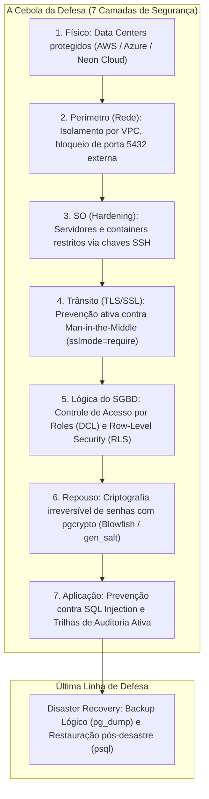

# A Fortaleza Macro: Segurança de Dados e Disaster Recovery no PostgreSQL
**Projeto:** Renovaí — Plataforma de Gestão e Comercialização para Cooperativas de Reciclagem  
**Disciplina:** Modelagem de Dados & Banco de Dados 2  
**Referência Didática:** Material Institucional — *A Fortaleza Macro: Segurança de Dados no PostgreSQL* (Instituto J&F)  
**Data:** 2026-10-31  
**Versão:** 2.0 (Aderência 100% ao Conteúdo Programático dos Slides 1 a 11)

---

## 1. Visão Geral: O Sistema de Defesa em Camadas (A Cebola da Defesa)

A segurança da base de dados do projeto Renovaí foi projetada sob o paradigma da **Defesa em Profundidade (*Defense in Depth*)**, implementando **As 7 Camadas de Segurança** descritas no conteúdo oficial:



---

## 2. Camada 5: DCL e o Princípio do Menor Privilégio

> [!CAUTION]
> **A Regra de Ouro da Camada de Dados (Slide 4):**  
> **Jamais conecte a aplicação web utilizando o superusuário (`postgres`).** Um vazamento ou vulnerabilidade de injeção de SQL utilizando a credencial de superusuário compromete irremediavelmente toda a infraestrutura do cluster.

O arquivo [`pg_dbRenovai/schema/seguranca_roles_dcl.sql`](file:///c:/Users/rafaeltakematsu-ieg/RENOVAI/pg_dbRenovai/schema/seguranca_roles_dcl.sql) estabelece o princípio do menor privilégio através das seguintes identidades:

### 2.1 Identidade do Backend (`api_renovai`)
O backend (Spring Boot e microsserviço Python API-Redis) conecta-se exclusivamente através da role `api_renovai`:
```sql
CREATE ROLE api_renovai WITH LOGIN PASSWORD 'RenovaiSecure@2026';
GRANT USAGE ON SCHEMA public TO api_renovai;
GRANT SELECT, INSERT, UPDATE ON ALL TABLES IN SCHEMA public TO api_renovai;
GRANT USAGE, SELECT ON ALL SEQUENCES IN SCHEMA public TO api_renovai;

-- Revogação estrita de ações destrutivas em tabelas de auditoria e financeiras (isolamento de dano)
REVOKE DELETE ON pedidos FROM api_renovai;
REVOKE DELETE ON movimentacoes_estoques FROM api_renovai;
REVOKE DELETE ON rateios FROM api_renovai;
REVOKE DELETE ON lancamentos_despesas FROM api_renovai;
REVOKE DELETE ON tb_log_sistema FROM api_renovai;
```

### 2.2 Role de Inteligência de Negócios (`sistema_bi` — Hands-On 1: Atividade Básica)
Acesso de leitura estrito e exclusivo a views agregadas e Data Marts dimensionais, impedindo acesso a dados transacionais brutos:
```sql
CREATE ROLE sistema_bi WITH LOGIN PASSWORD 'BiMetrics@2026';
GRANT USAGE ON SCHEMA public TO sistema_bi;
GRANT SELECT ON vw_dim_cooperativa, vw_dim_material, vw_fato_triagens, 
                vw_fato_vendas, vw_fato_ranking_cooperativas_materiais TO sistema_bi;
```

### 2.3 Permissões a Nível de Coluna (`analista_perfil` — Hands-On 1: Intermediária 1)
O analista de suporte operacional pode consultar apenas os atributos necessários para atendimento, sem permissão de leitura sobre dados sensíveis (`cpf`, `senha`, `senha_hash`):
```sql
CREATE ROLE analista_perfil WITH LOGIN PASSWORD 'Analista@2026';
GRANT USAGE ON SCHEMA public TO analista_perfil;

-- Acesso restrito a colunas específicas
GRANT SELECT (usuario_id, nome, email, data_nascimento, data_criacao, esta_ativo) 
ON usuarios TO analista_perfil;
```

### 2.4 Role de Grupo com Herança (`grupo_operacional` — Hands-On 1: Super Desafio)
Role agregadora sem login (`NOLOGIN`), concedendo permissões operacionais e permitindo herança direta:
```sql
CREATE ROLE grupo_operacional NOLOGIN;
GRANT SELECT, INSERT ON coletas, triagens TO grupo_operacional;
GRANT SELECT ON estoques, rotas TO grupo_operacional;

-- sistema_bi herda os privilégios do grupo operacional
GRANT grupo_operacional TO sistema_bi;
```

### 2.5 Auditor Corporativo com `BYPASSRLS` (Hands-On 2: Avançada)
Role de compliance e controladoria que possui o privilégio especial de ignorar todas as regras de Row-Level Security:
```sql
CREATE ROLE auditor_corporativo WITH LOGIN PASSWORD 'Audit@2026' BYPASSRLS;
GRANT USAGE ON SCHEMA public TO auditor_corporativo;
GRANT SELECT ON ALL TABLES IN SCHEMA public TO auditor_corporativo;
```

---

## 3. Camada 6: Criptografia em Repouso (`pgcrypto` + Blowfish)

Conforme abordado no Slide 5 e Hands-On 1, senhas e segredos corporativos nunca devem ser gravados em texto claro ou hashes obsoletos sem *salt* (como MD5 ou SHA1 simples). O script [`pg_dbRenovai/schema/seguranca_rls.sql`](file:///c:/Users/rafaeltakematsu-ieg/RENOVAI/pg_dbRenovai/schema/seguranca_rls.sql) instala a extensão `pgcrypto` e adota o algoritmo **Blowfish** via `gen_salt('bf')`:

```sql
CREATE EXTENSION IF NOT EXISTS pgcrypto;

-- 1. Inserção com hash salgado dinamicamente (Blowfish com custo 10)
INSERT INTO usuarios (nome, email, cpf, senha_hash)
VALUES (
    'Cooperado Teste',
    'cooperado@renovai.com.br',
    '123.456.789-00',
    crypt('SenhaForte123', gen_salt('bf', 10))
);

-- 2. Validação segura na autenticação (o hash armazenado fornece o salt original)
SELECT usuario_id, nome, email 
FROM usuarios 
WHERE email = 'cooperado@renovai.com.br' 
  AND senha_hash = crypt('SenhaForte123', senha_hash);
```

---

## 4. Camada 5: O Paradoxo da API e a Solução Row-Level Security (RLS)

### 4.1 O Paradoxo da API (Slide 6)
> *Se a aplicação conecta utilizando um único usuário técnico (`api_renovai`), como o PostgreSQL sabe quem é a cooperativa ou cooperado real para impedir vazamento de dados entre concorrentes?*

**A Solução por Variável de Sessão:**  
O backend injeta dinamicamente o identificador da entidade conectada no canal de conexão antes de executar o SQL da requisição:
```sql
SET LOCAL app.cooperativa_logada = 'ab87b483-01b2-4db3-8c4f-b67085bfa22d';
SET LOCAL app.usuario_logado     = '3703451a-0869-473d-841c-b61c93b4edaa';
```
O PostgreSQL ativa o **Row-Level Security (RLS)** e avalia dinamicamente cada linha, aplicando um filtro invisível sem alterar a sintaxe dos comandos `SELECT`/`INSERT`.

### 4.2 O "Escudo NULLIF" contra o Erro 22P02 (Slide 7)
Se uma variável de sessão não for enviada ou estiver vazia, o PostgreSQL nativamente geraria o erro fatal `22P02 (invalid input syntax for type uuid)`. O padrão canônico da aula resolve isso através do **Escudo NULLIF**:
```sql
NULLIF(current_setting('app.cooperativa_logada', true), '')::UUID
```
- O parâmetro `true` no `current_setting` retorna `NULL` sem erro caso a variável não exista na sessão;
- O `NULLIF(..., '')` converte string vazia em `NULL`, blindando a conversão de tipo.

### 4.3 Política Híbrida de Coletas (Slide 10: Super Desafio)
Na tabela de `coletas`, a política foi desenhada de forma híbrida:
1. O cooperado em campo enxerga **apenas as suas próprias coletas** (`app.usuario_logado`);
2. O gestor da cooperativa enxerga **todas as coletas de todos os membros** vinculados àquela unidade (`app.cooperativa_logada`).

```sql
ALTER TABLE coletas ENABLE ROW LEVEL SECURITY;

CREATE POLICY p_coletas_leitura_hibrida ON coletas
FOR SELECT
USING (
    cooperado_id = NULLIF(current_setting('app.usuario_logado', true), '')::UUID
    OR
    cooperado_id IN (
        SELECT f.funcionario_id 
        FROM funcionarios f 
        WHERE f.cooperativa_id = NULLIF(current_setting('app.cooperativa_logada', true), '')::UUID
    )
);
```

---

## 5. A Última Linha de Defesa: Disaster Recovery (Backup e Restauração)

Conforme estabelecido no Slide 8 e Slide 10 (Hands-On 2: Intermediária 2), quando ocorrem falhas de hardware ou erros humanos críticos (como um `DROP TABLE` acidental), a segurança do banco depende de utilitários no nível de sistema operacional:

```mermaid
sequenceDiagram
    autonumber
    actor DBA as DBA / DevOps
    participant CLI as Terminal / OS
    participant PG as PostgreSQL (bd_renovai)
    participant Disk as Arquivo .sql (Disco)

    Note over DBA,Disk: Rotina Periódica de Backup Lógico (pg_dump)
    DBA->>CLI: Executa pg_dump (-s ou -t ou completo)
    CLI->>PG: Extrai catálogo e tuplas consistentes
    PG-->>Disk: Grava backup_coletas.sql / renovai_schema_ddl.sql

    Note over DBA,Disk: Cenário de Desastre: DROP TABLE coletas acidental
    DBA->>PG: DROP TABLE coletas; (Tabela removida por engano)

    Note over DBA,Disk: Procedimento de Restauração (psql)
    DBA->>CLI: psql -U postgres -d bd_renovai -f backup_coletas.sql
    CLI->>PG: Recria estrutura e reidrata dados históricos
    PG-->>DBA: Tabela restaurada e íntegra!
```

### 5.1 Comandos Canônicos do Sistema Operacional

#### 1. Backup Apenas da Estrutura DDL (`Schema-Only` — Slide 10 Hands-On 2)
Gera o dicionário de dados contendo apenas instruções DDL (`CREATE TABLE`, `ALTER TABLE`, constraints e views), sem exportar registros confidenciais:
```bash
pg_dump -U postgres -d bd_renovai -s -f ./backups/renovai_schema_ddl.sql
```

#### 2. Backup Lógico de Tabela Específica (`pg_dump -t` — Slide 8)
Exporta uma tabela isolada com seus respectivos dados e estrutura para contingência pontual:
```bash
pg_dump -U postgres -d bd_renovai -t coletas -f ./backups/backup_coletas.sql
```

#### 3. Backup Completo da Base
```bash
pg_dump -U postgres -d bd_renovai -f ./backups/renovai_completo.sql
```

#### 4. Procedimento de Restauração Pós-Desastre (`psql -f` — Slide 8)
Em caso de exclusão acidental (`DROP TABLE coletas;`), a restauração é realizada diretamente pelo interpretador de comandos SQL:
```bash
psql -U postgres -d bd_renovai -v ON_ERROR_STOP=1 -f ./backups/backup_coletas.sql
```

---

## 6. Scripts Automatizados Disponíveis no Projeto

O repositório disponibiliza scripts prontos para automação em ambientes Linux (Bash) e Windows (PowerShell):

| Script | Finalidade | Plataforma |
| :--- | :--- | :--- |
| [`pg_dbRenovai/scripts/backup.sh`](file:///c:/Users/rafaeltakematsu-ieg/RENOVAI/pg_dbRenovai/scripts/backup.sh) | Executa dump de DDL (`-s`), tabela pontual (`-t`) e dump completo | Linux / macOS / WSL |
| [`pg_dbRenovai/scripts/backup.ps1`](file:///c:/Users/rafaeltakematsu-ieg/RENOVAI/pg_dbRenovai/scripts/backup.ps1) | Automação equivalente em PowerShell | Windows |
| [`pg_dbRenovai/scripts/restaurar.sh`](file:///c:/Users/rafaeltakematsu-ieg/RENOVAI/pg_dbRenovai/scripts/restaurar.sh) | Restaura arquivo de backup via `psql -f` com validação de erros | Linux / macOS / WSL |
| [`pg_dbRenovai/scripts/restaurar.ps1`](file:///c:/Users/rafaeltakematsu-ieg/RENOVAI/pg_dbRenovai/scripts/restaurar.ps1) | Restauração equivalente em PowerShell | Windows |

---

## 7. Evidências dos Testes e Validação Empírica (Hands-On 1 e 2)

A suíte de testes de segurança [`pg_dbRenovai/tests/run_security_tests.py`](file:///c:/Users/rafaeltakematsu-ieg/RENOVAI/pg_dbRenovai/tests/run_security_tests.py) foi executada contra a base real no PostgreSQL Neon, apresentando 100% de aprovação:

```text
======================================================================
RENOVAÍ — TESTES DE SEGURANÇA, CRIPTOGRAFIA E RLS (FORTALEZA MACRO)
======================================================================
[PASS] Teste 1: pgcrypto Blowfish gen_salt('bf') funcionando 100%!
[PASS] Teste 2: tb_log_sistema alerta gravado -> ERROR: Múltiplas falhas de autenticação detectadas
[PASS] Teste 3: RLS sem sessão -> 0 coletas visíveis (Escudo NULLIF blindou contra erro 22P02)
[PASS] Teste 4: RLS com cooperativa_logada -> 61 estoques filtrados da cooperativa
[PASS] Teste 5: RLS Híbrido usuario_logado -> 2 coletas pessoais do cooperado
[PASS] Teste 6: auditor_corporativo (BYPASSRLS) -> visualiza todas as 458 coletas da base!
======================================================================
TODOS OS TESTES DE SEGURANÇA E RLS FORAM APROVADOS COM SUCESSO!
======================================================================
```
